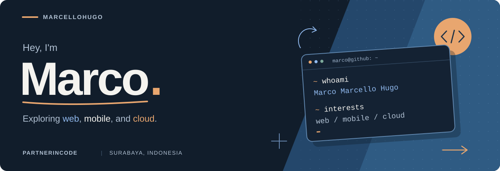

  

  <a href="https://marcello.web.id"><strong>Portfolio ↗︎</strong></a>
  &nbsp; / &nbsp;
  <a href="https://www.linkedin.com/in/marcellohugo/">LinkedIn</a>
  &nbsp; / &nbsp;
  <a href="https://www.instagram.com/marcellohugo__/">Instagram</a>
  &nbsp; / &nbsp;
  <a href="https://github.com/Marcellohugo?tab=repositories">Repositories</a>

## A little about me

I'm **Marco**, an Informatics Engineering student at **Institut Teknologi Sepuluh Nopember (ITS)**, based in Surabaya, Indonesia. I'm exploring web development, mobile apps, and cloud technologies through coursework and projects.

Currently learning **full-stack development** and how to build software that's easier to use, understand, and maintain.

## Selected work

<table>
  <tr>
    <td width="50%" valign="top">
      <h3>01 &nbsp; ResearchMate</h3>
      
A research assistant with AI agents, private PDF documents, and retrieval-augmented generation.

      
<strong>LARAVEL &nbsp; / &nbsp; POSTGRESQL &nbsp; / &nbsp; QDRANT</strong>

      <a href="https://github.com/Marcellohugo/Researchmate"><strong>View ResearchMate ↗︎</strong></a>
    </td>
    <td width="50%" valign="top">
      <h3>02 &nbsp; WebGL Playground</h3>
      
An interactive 3D scene exploring camera controls, atmospheric lighting, and rendering on the web.

      
<strong>THREE.JS &nbsp; / &nbsp; VITE &nbsp; / &nbsp; TAILWIND CSS</strong>

      <a href="https://github.com/Marcellohugo/GrafkomwebGL"><strong>View WebGL project ↗︎</strong></a>
    </td>
  </tr>
</table>

**Also exploring mobile:** [Android Student Manager ↗︎](https://github.com/Marcellohugo/PemrogramanPerangkatBergerak) — student search and data management with Java, Kotlin, SQLite, camera integration, and APIs.

## Languages & tools

| Area | Technologies |
| :--- | :--- |
| **Languages** | JavaScript · TypeScript · PHP · Java · Kotlin · Go · C# |
| **Web** | React · Next.js · Vue · Nuxt · Angular · Svelte · Tailwind CSS · HTML · CSS · Sass |
| **Backend** | Laravel · Node.js · Express · NestJS · .NET · Blazor |
| **Mobile** | Android · Flutter · React Native |
| **Data** | MySQL · PostgreSQL · MariaDB · Firebase |
| **Cloud & systems** | AWS · Docker · Kubernetes · Linux · Bash · PowerShell |
| **Workflow** | Git · Postman · Figma |

  
More tools I've explored

   
  AngularJS · VuePress · Vuetify · WordPress · Windows · Selenium · Unity

## On GitHub

  

  <a href="https://github.com/Marcellohugo?tab=repositories">Browse all repositories ↗︎</a>
  &nbsp; · &nbsp;
  <a href="https://github.com/Marcellohugo?tab=overview">View contributions ↗︎</a>

---

  Always learning. One project at a time.

